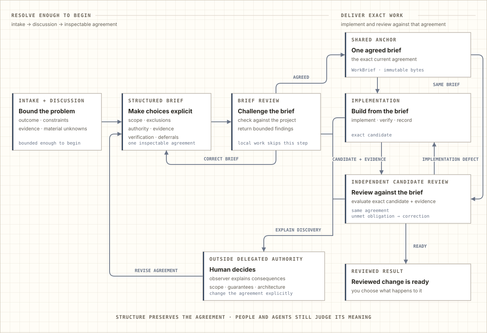
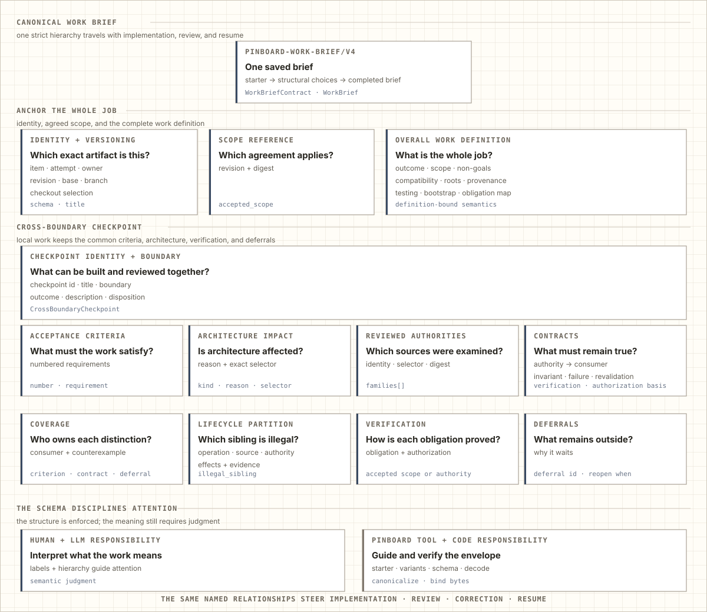
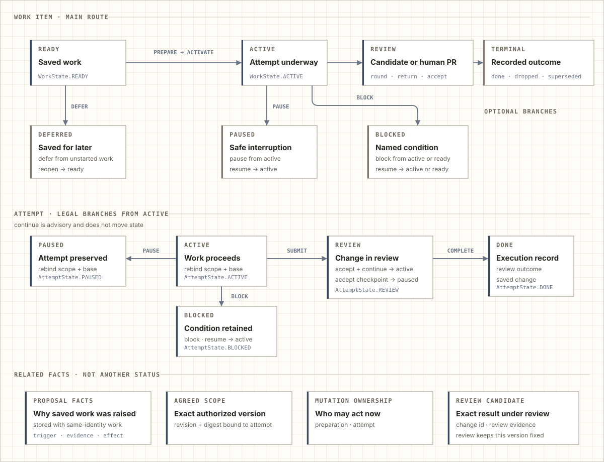
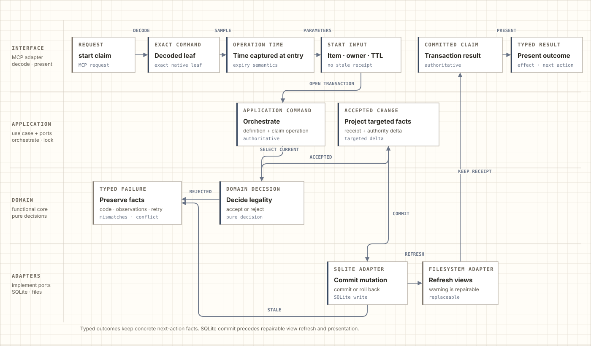

<!-- Generated by docs.how_it_works from executable seeds. Do not edit this file directly. -->

# How Pinboard works

Picture a product you are building with a coding agent. On Monday you start an export feature. By Wednesday the agent has noticed that the storage layer fights every new format, two product ideas came up during a review, and a refactoring would make next month's work easier. Each of these is worth doing, and none of them is the export feature. A few weeks of this and the chat history is the only record of why anything was decided, while the product drifts toward whatever came up last.

Pinboard keeps the product on target through those weeks. It gives detours somewhere to go, keeps the reasons and decisions next to the work, and makes sure that whatever is saved survives interruptions, new sessions and replacement agents. The golden rule is to never lose work and keep going.

This article follows one piece of work from the moment it is saved to the moment you decide its fate. Then it looks under the hood: how every answer Pinboard gives an agent leaves it a next step, how the code is organized as a functional core with ports and adapters, and how strict static checks keep a large Python codebase in shape.

Pinboard works with local Git-backed repositories, and the structure has a cost: recording goals and evidence makes the first delivery slower. For a short, disposable change, working with a coding agent directly is usually enough.

## Saved work and the runs that carry it out

The board holds **work items**. An item records a goal, its boundaries and the evidence that prompted it. Saving an item starts nothing. When the agent spots that storage re-architecture in the middle of the export feature, it saves the idea with what it found and goes back to the feature. The detour is parked, and it is still there when you are ready for it.

Items carry a priority order that only you change and dependencies that say what has to land first. Ask what to do next and the agent reads both, then tells you what is ready, what is waiting and what it would pick. Ask what can run at the same time and it previews a safe set of independent items, then launches only the ones you choose, in separate checkouts. Initiatives group items under a shared goal and an observable success signal. A generated roadmap orders their remaining work in dependency waves, and you record whether the goal was actually met separately from whether its items were delivered.

Starting an item creates an **attempt**: one run of work on that item. The distinction matters because runs end in untidy ways. An attempt can pause at a useful point, go back for correction, be picked up by a fresh agent, or stop because the plan changed. The item, and the decision behind it, outlives all of that.

## Agree, build, and have someone else check

Before any code changes, the agent works through the material open questions with you and writes the result down as a brief.

<picture>
  <source media="(prefers-color-scheme: dark)" srcset="assets/how-it-works/ambiguity-closure-dark.svg">
  
</picture>

The brief is the single agreement both sides work from. The implementing agent builds against it, runs the checks it names, and submits the exact change with its evidence. A separate coding agent, one that did not write the change, then reviews that exact version against the same brief. For work that crosses architectural boundaries, another agent reviews the brief itself before implementation starts; local work skips that step.

When the reviewer finds an implementation defect, the work returns to the same attempt for correction and another review. When either agent discovers something that would change the product scope, the architecture or compatibility, it stops and brings that decision to you. If you change the agreement, Pinboard replaces the definition and brief before the affected work continues, so review always compares the change with what you actually asked for.

A favorably reviewed change does not land by itself. You decide whether to merge it, keep it on its branch as an experiment, or drop it. A merged pull request is not proof of review either: if a change was published first, the agent can still send the saved version for review and tell you which commits that review covered. [Using Pinboard in conversation](GUIDE.md) walks through these cases, including the review of a pull request written by a person.

The brief itself is a strict structured record rather than free prose.

<picture>
  <source media="(prefers-color-scheme: dark)" srcset="assets/how-it-works/brief-dark.svg">
  
</picture>

It pins the agreed scope by revision and digest, and lays out the outcome, non-goals, acceptance criteria, architecture impact and required verification in named fields. The implementer gets a bounded job, the reviewer gets the same checklist, and a new session can resume without rereading old chat. Pinboard validates the brief's structure, identities and bytes. Whether its choices are sound remains a judgment for you and the agents.

## No dead ends for the agent

An agent working through a long task will get things wrong: a stale receipt, a lease that expired over lunch, a claim on an item another agent is already preparing. What matters is what happens next. Across Pinboard's 32 MCP tools, every result, success or rejection, tells the agent what happened and what it can do now.

Here is what a second agent receives when it tries to start preparing an item that another agent is still preparing:

```json
{
  "schema": "pinboard-mcp-preparation-authority-result/v1",
  "status": "rejected",
  "item_id": "storage-rearchitecture",
  "code": "ACTION_NOT_AVAILABLE",
  "message": "Preparation authority remains live. Follow next_step_tool with next_step_input in observed to inspect the current subject. …",
  "conflict": {"task_id": "…", "host_id": "…", "lease_id": "…", "generation": 1, "expires_at": "2026-10-29T22:00:07+00:00", "authority_status": "active"},
  "state_changed": false,
  "effect": "unchanged",
  "retry": "refresh-action",
  "changed_surfaces": [],
  "observed": [
    {"field": "next_step_tool", "value": "pinboard_item_status"},
    {"field": "next_step_input", "value": "{\"request\":{\"item_id\":\"storage-rearchitecture\",\"operation\":\"item\",…}}"}
  ],
  "mismatches": []
}
```

Each field answers a question the agent would otherwise have to guess. `state_changed` and `effect` say nothing was written. `retry` says that resending the same request will not help and that the agent should refresh its view of the available actions. `conflict` names who holds the item and until when. `observed` carries an exact next call: `pinboard_item_status` with a ready-made input that shows the item's current state. The full message also names the one thing the agent must not do, which is borrow or revoke the other agent's lease without authorization.

Successful results follow the same pattern. A committed lease acquisition reports `"effect": "committed"`, `"retry": "do-not-retry"` and `"changed_surfaces": ["ledger"]`, so an agent that lost the reply knows not to replay it. When the database commit succeeds but refreshing the readable views fails, the result says the commit stands and gives a recovery step, usually `pinboard views rebuild`, rather than a replay. The agent never has to reconstruct state from source code or chat history. Each new agent-facing operation is checked against the [design principle](DESIGN_PRINCIPLES.md#leave-evidence-an-agent-can-diagnose-from) behind this.

## Work survives interruptions

Long-running work gets interrupted, and the board is built around that.

<picture>
  <source media="(prefers-color-scheme: dark)" srcset="assets/how-it-works/product-dark.svg">
  
</picture>

Only one agent at a time acts for an attempt. It holds a time-limited lease and renews it as it works. When that agent stops or crashes, its lease runs out and a new agent can take over with a fresh one; the old lease can no longer change anything. Pausing records a reason that stays visible in item status and the item's readable view until the work resumes. A paused attempt can also be rebound to a revised brief or a new base revision while keeping its history. At every step the agent asks Pinboard which actions are legal in the current state instead of guessing, and if the stored item and attempt records ever disagree, discovery stops before offering any choice.

Four guarantees hold across all of these paths:

- **Intent survives conversations.** Later work continues from the recorded goal and evidence instead of reconstructing intent from chat.
- **Only the current worker may act.** A replaced or expired lease cannot apply a stale decision.
- **Review concerns one candidate.** Findings and acceptance stay bound to the exact change that was examined.
- **Authoritative changes are atomic.** A rejected or failed transition leaves the previous ledger intact.

The same care applies at the end. A merge alone does not close an item: the agent checks that the reviewed change reached the target branch, even after a rebase or squash merge, and records completion when you decide. A change you keep off the main branch, such as an experiment, stays on its branch, and the item says so. Cancelling an obsolete item asks for your separate confirmation, then records it as dropped while keeping its code and evidence. Pinboard checks branches as they are stored locally, so it cannot prove a remote is up to date; the agent fetches first when that matters. A negative answer is not proof that the change was left out either, because later edits to the same code can hide it.

## A functional core with ports and adapters

Pinboard is about 58,000 lines of production Python, and most of it is deliberately boring. The size comes from being precise about what an agent may do and what it is told, not from clever machinery. The part worth showing off is the shape: a functional core surrounded by ports and adapters.

The domain is the functional core, about 5,300 of those lines. It holds immutable values and pure decisions, such as whether a transition is legal or whether a lease still owns an attempt. It reads no files, issues no SQL and knows nothing about MCP or the command line. Around it, the application layer runs use cases: it opens transactions, rereads current facts, asks the domain to decide, and turns an accepted decision into a targeted change. It reaches storage only through ports, Python protocols that describe what a use case needs without saying how it is done. SQLite and filesystem adapters implement those ports. The MCP server and the command-line interface sit on the outside as two more adapters; each decodes its own transport, composes the concrete adapters with the shared use cases, and presents results in its own format. Dependency tests keep every arrow pointing inward.

Starting a preparation claim shows the whole path.

<picture>
  <source media="(prefers-color-scheme: dark)" srcset="assets/how-it-works/journey-dark.svg">
  
</picture>

The MCP adapter decodes the request into an exact command with no loose fields, and records the operation time once, so the claim's start and expiry come from the same moment. The application use case opens a write transaction through its storage port, rereads the item's definition and any existing claim, and selects either a first acquisition or a transfer from an inactive holder. The domain decides whether that change is legal. A rejection becomes the typed failure shown earlier. An accepted decision is projected into a targeted mutation, which the SQLite adapter commits or rolls back; a stale guard at commit time also becomes a typed failure. Only after the commit does the filesystem adapter refresh the readable views, and only then does the MCP adapter present the result.

If you are putting an MCP server in front of an application you already have, this shape is worth copying. The MCP server becomes one more adapter beside your existing interface instead of a second copy of the business rules. The core can be tested without a database or a protocol. Strict decoding at the edge rejects a malformed agent request before it reaches a decision, and typed results from the core give the adapter real facts to turn into a next step. The [architecture map](ARCHITECTURE.md) documents each owner and the dependency direction.

## Strict Python that agents can work in

Python happily runs code that looks plausible and is subtly wrong, and coding agents produce plenty of plausible code. Pinboard answers with checks strict enough that a wrong guess fails before a reviewer ever sees it.

Pyrefly runs in strict mode, and a coverage check requires 100% strict type coverage of the production code. ty checks the same paths with every rule raised to an error, apart from three optional soundness rules whose reasons are recorded in `pyproject.toml`. Ruff covers formatting and a broad lint set, and its banned-API list rejects the usual escape hatches: `typing.Any`, `typing.cast` and `StrEnum`.

Data from outside, whether an MCP request, a stored record or a config file, is decoded straight into frozen `msgspec.Struct` records. Pinboard-owned formats reject unknown fields, so a misspelled key fails loudly instead of being ignored. Inside, closed families of states and commands are handled with exhaustive `match` statements that end in `assert_never`, as in this excerpt from the preparation path, with each branch's body left out:

```python
match requested_change:
    case authority_models.AcquireInitialPreparationAuthority():
        ...
    case authority_models.TransferPreparationAuthority():
        ...
    case authority_models.RenewPreparationAuthority():
        ...
    case authority_models.ReleasePreparationAuthority():
        ...
    case authority_models.RevokePreparationAuthority():
        ...
    case _ as unreachable:
        assert_never(unreachable)
```

Add a new variant and every `match` that forgot it fails the type check, which turns "did I update every place?" from a memory test into a type error. The production code has more than 200 of these exhaustive endings.

Duplication gets the same treatment. jscpd scans the production code for repeated blocks, and CI rejects any new clone relative to `main` and enforces a recorded ceiling. Copying is what an agent does when it cannot find the right owner for a piece of behavior, and the gate sends it looking. [Contributing](CONTRIBUTING.md#run-the-checks) lists the full check sequence.

## Where to go next

For installation and the product overview, return to the [README](README.md). [Using Pinboard in conversation](GUIDE.md) shows the same workflow from the conversation side. Maintainers can continue with the [architecture map](ARCHITECTURE.md) and the [design principles](DESIGN_PRINCIPLES.md).

---

<sub>This guide and its four SVG diagrams are generated from the executable seeds in <code>docs/how_it_works/</code>. Edit the seeds and regenerate the outputs; do not edit this file directly.</sub>
