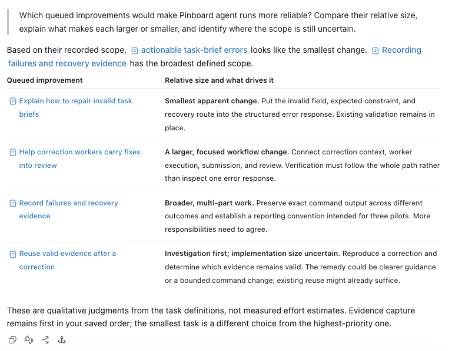

# Pinboard

## Keep your product on target while coding agents build it


Building a product with a coding agent over weeks means juggling product ideas, research, implementation, and the detours that keep appearing: a module that needs re-architecting, a refactoring that would make the next feature easier, a bug spotted halfway through something else. Pinboard keeps that work in order so the product you meant is the one that gets built. A detour is parked as saved work instead of taking over the current feature, and it still gets done later.

The rule is simple: saved work is never lost. Ideas, decisions, and changes in progress are recorded in your repository, so you can stop at any point and pick up days later, in a new session, from where the work was left.

Pinboard also covers the agent workflows you may be looking for: long-running work that survives pauses and new sessions, several tasks running in parallel in separate worktrees, and review of each implemented change by a separate coding agent against the brief you agreed. You decide what reaches your repository.

<br clear="right">
<br>

[](https://github.com/valsteen/pinboard/actions/workflows/ci.yml)
[](https://www.python.org/downloads/)
[](https://docs.astral.sh/uv/)
[](https://github.com/astral-sh/ty)
[](LICENSE)

## Use it in conversation

Use `$pinboard` in Codex or `/pinboard:pinboard` in Claude Code, or ask for the `pinboard` skill in Antigravity, then talk normally:

> While we finish the export feature: the storage layer really needs a re-architecture. Save that with what we found, and keep going.

The detour goes on the board with its evidence, unstarted, and the export feature carries on.

> Let's do the storage re-architecture now.

The agent settles open questions with you, writes a brief, implements it, and has a separate agent review the change. You choose what happens to the reviewed change.

> Where did we leave off?

The agent reads the saved goal, change, and review, then names the next step.

[Using Pinboard in conversation](GUIDE.md) has more examples: seeing items through, checking they're really done, handing work over, parking rabbit holes, and parallel work.

## Plan what comes next

Pinboard keeps your saved priority order, the dependencies between items, and which work is ready to start. Ask what to do next and the agent explains which items are ready, which are waiting on another change, and what it would pick. Ask what can run at the same time and it shows the safe set and why the rest must wait. Initiatives group items under a goal and a success signal, with a roadmap that orders their remaining work by dependency.

You can also ask for a comparison. Here the agent weighs four queued Pinboard improvements by size and uncertainty:

<picture>
  <source media="(prefers-color-scheme: dark)" srcset="assets/pinboard-work-selection-dark.png">
  
</picture>

The answer links to each saved item and notes that the smallest task is not the top priority. Planning never starts or reorders work; the order changes only when you say so.

## When Pinboard is worth it

Pinboard pays off when a decision has to survive another session, an interruption, a reviewer, or a detour. Recording goals, scope, and evidence makes the first delivery slower, and that cost returns when you revisit the work. For a small or disposable change, using the coding agent directly is often the better choice.

## Install from GitHub

Pinboard works in local Git repositories on macOS and Linux and needs [uv](https://docs.astral.sh/uv/) for first-time setup. Codex is the primary, stress-tested integration; Claude Code and Antigravity CLI (`agy`) are also supported.

### Codex

```sh
codex plugin marketplace add valsteen/pinboard
codex plugin add pinboard@pinboard
```

### Claude Code

```sh
claude plugin marketplace add valsteen/pinboard
claude plugin install pinboard@pinboard
```

[Claude Code setup](INSTALL.md#claude-code) covers first-session preparation and context settings.

### Antigravity

```sh
git clone https://github.com/valsteen/pinboard.git
agy plugin install /path/to/pinboard
```

Antigravity needs one permission rule before Pinboard's tools run; [Antigravity setup](INSTALL.md#antigravity) shows it.

Then start a task in your project and ask:

> Set up Pinboard here and explain how I can use it from one task or several tasks.

The [installation guide](INSTALL.md) covers permissions, linked worktrees, trying Claude Code for one session without installing, and troubleshooting.

## More skills

Pinboard brings specialized skills into the work when it calls for them. Invoke one directly as `$<skill>` in Codex or `/pinboard:<skill>` in Claude Code, or ask for it by name in Antigravity.

| Skill | Use it to |
| --- | --- |
| `investigation-focus` | Investigate a question and produce an evidence-based result. |
| `technical-writing` | Shape substantial technical documents. |
| `repository-readiness` | Understand an unfamiliar repository before changing it. |
| `slop-cleanup` | Remove abandoned code and its residue. |
| `maintaining-agent-guidance` | Keep durable instructions at the right owner. |

For investigation setup and continuity across sessions, see [Use Investigation Focus](INSTALL.md#use-investigation-focus).

## Local data

Project decisions and evidence stay in the repository's ignored `.pinboard` directory, shared by primary and linked worktrees. Pinboard's runtime is separate from your project's Python environment. See [Local data](INSTALL.md#local-data) for locations and migration.

## Learn more

- [How Pinboard works](HOW_IT_WORKS.md) explains how saved work stays on target and how Pinboard is built.
- [Contributing](CONTRIBUTING.md) covers development, checks, and packaging.
- [Architecture](ARCHITECTURE.md) describes system ownership, boundaries, and limitations.
